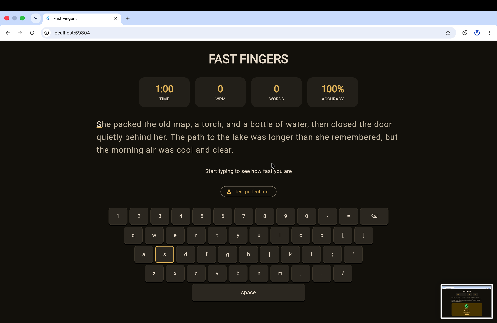
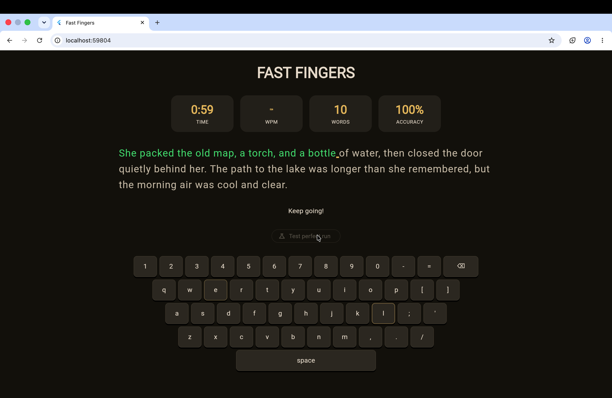

# Fast Fingers

A fun, simple Flutter web app to test your typing speed.

A passage appears on screen and the timer starts as soon as you begin typing. Correct letters turn green and mistakes turn red, while an on screen keyboard lights up the keys as you press them. Your speed, word count and accuracy update live, and you have 60 seconds or until the passage ends.

There are two modes. Normal mode is where you type the passage yourself, and you can restart at any time with the Restart button or the Esc key. Test mode types a perfect run for you, so you can see the success screen. It is only shown when running in debug mode.

To run it, use flutter run -d chrome.

## Screenshots

Ready to start

Typing in progress

## Demo

https://github.com/user-attachments/assets/a1916280-eb3a-436b-9acd-4fef42e48e0c

